 

---

## 👨‍💻 About Me

I'm a **Computer Science student at FAST NUCES, Karachi Campus**. I completed my **A-Levels at Beaconhouse** with Computer Science as my major, which is where my interest in programming and problem solving began.

I enjoy turning ideas into working software, learning new technologies, and steadily improving my skills through hands-on projects. I'm always open to collaboration and learning opportunities.

- 🎓 Studying Computer Science at **FAST NUCES, Karachi**
- 📘 A-Levels (Computer Science) from **Beaconhouse**
- 🌱 Currently strengthening my fundamentals and building projects
- 🤝 Open to collaborating on projects and learning from others
- 📫 Reach me at **moazamuddinshaikh01@gmail.com**

---

## 🛠️ Tools I Work With

---

## 🚀 Latest Projects

<!-- PROJECTS:START -->
<table>
  <tr>
    <td width="50%" valign="top">
      <h3>📁 <a href="https://github.com/Moazamuddin12/BlockBox">BlockBox</a></h3>
      
A local desktop tracking and system monitoring application with a PySide6 GUI and automated setup scripts.  Option 2 (Feature-Focused)

      
<b>Language:</b> Batchfile · ⭐ 0

    </td>
    <td width="50%" valign="top">
      <h3>📁 <a href="https://github.com/Moazamuddin12/VaultLock-File-Encrypter-and-Decrypter-">VaultLock-File-Encrypter-and-Decrypter-</a></h3>
      
No description added yet.

      
<b>Language:</b> Python · ⭐ 0

    </td>
  </tr>
</table>
<!-- PROJECTS:END -->

---

## 📊 GitHub Statistics

 

---

## 🐍 Contribution Snake

<picture>
  <source media="(prefers-color-scheme: dark)" srcset="https://raw.githubusercontent.com/Moazamuddin12/Moazamuddin12/output/github-snake-dark.svg" />
  <source media="(prefers-color-scheme: light)" srcset="https://raw.githubusercontent.com/Moazamuddin12/Moazamuddin12/output/github-snake.svg" />
  
</picture>

---

## 🤝 Let's Connect

I'm happy to connect with fellow students, developers and recruiters.

